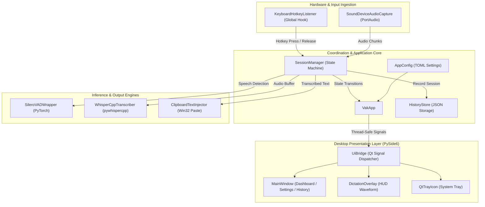

# Vāk (वाक्) – Windows Desktop Speech-to-Text Application

> **Local-first, privacy-focused, hold-to-dictate speech-to-text utility for Windows.**

---

## Download for Windows

[](https://apps.microsoft.com/detail/9MZ5MB2W0DFN?hl=en-us&gl=IN&ocid=pdpshare)

Get Vāk directly from the Microsoft Store for a secure and convenient installation:

👉 **[Download Vāk on the Microsoft Store](https://apps.microsoft.com/detail/9MZ5MB2W0DFN?hl=en-us&gl=IN&ocid=pdpshare)**

*Looking to build or contribute from source? See the [Developer Installation Instructions](#9-installation-instructions) below.*

---

## 1. Project Introduction

**Vāk** (derived from Sanskrit **वाक्**, meaning *speech*, *voice*, or *sacred utterance*) is an offline, local-first Windows desktop speech-to-text application. Designed as an unobtrusive system utility, Vāk enables global hold-to-dictate functionality across any Windows application: hold down a hotkey, speak into your microphone, release the key, and watch your spoken words instantly transcribed and injected into the active text field.

---

## 2. Problem Statement

Most modern voice-typing tools rely on cloud APIs, which present several challenges:
- **Privacy & Confidentiality Risks:** Voice recordings and dictation content are transmitted to third-party remote servers, making them unsuitable for confidential code, sensitive documents, and proprietary communication.
- **Network Dependency & Latency:** Cloud dictation requires steady, low-latency internet connectivity and is unavailable in offline or restricted intranet environments.
- **Subscription Costs & Rate Limits:** Cloud-based APIs often incur recurring charges or strict usage quotas.
- **Fragmented Desktop Integration:** Existing open-source speech utilities often lack clean global hotkey handling, seamless clipboard injection, reliable state management, and modern Windows desktop user interfaces.

Vāk solves these challenges by providing a 100% on-device speech-to-text pipeline combining high-accuracy Voice Activity Detection (VAD) and `whisper.cpp` inference into a lightweight Windows desktop utility.

---

## 3. Key Features

- **100% Local & Privacy-Preserving:** All audio capture, voice activity filtering, and speech inference execute entirely on your local machine. No audio or text ever leaves your system.
- **Global Hold-to-Dictate:** Press and hold a configurable global shortcut (default: `F9`) from any focused application, speak naturally, and release to transcribe and paste.
- **Modern Fluent UI Dashboard:** Built with PySide6 (Qt 6), featuring a clean desktop interface with Home, History, Settings, About, and Roadmap pages.
- **Real-Time Floating Overlay HUD:** A lightweight, non-intrusive floating HUD displays real-time state feedback (*Listening*, *Transcribing*) and animated speech waveforms.
- **High-Performance Speech Recognition:** Powered by `pywhispercpp` (Python bindings for `whisper.cpp` GGML models) with configurable multi-threading for fast, responsive transcription.
- **Silero Voice Activity Detection (VAD):** Pre-filters audio buffers to discard background silence, ensuring fast turnaround times and preventing empty transcriptions.
- **Seamless Text Injection:** Injects transcribed text directly into the target active window using simulated paste with automatic preservation and restoration of previous clipboard contents.
- **Integrated Model Setup Manager:** First-launch onboarding dialog allows users to download standard GGML models (`tiny.en`, `base.en`, `small.en`) with SHA-256 integrity verification, or link existing local model files.
- **Searchable Transcription History:** Persistent local history store lets users review past dictations, search by keyword, copy text, or purge items.
- **System Tray Native Integration:** Runs in the Windows taskbar notification area with status indicator badges, quick actions, settings launcher, and clean shutdown handling.
- **Windows Startup Integration:** Option to launch silently in the system tray when Windows boots.
- **Diagnostics & Benchmarking:** Built-in RMS audio level meters, input device diagnostics, and CPU/memory/Real-Time-Factor (RTF) session performance metrics.

---

## 4. How Vāk Works

The lifecycle of a dictation session flows through a deterministic event-driven pipeline:

```
[User Holds Hotkey (e.g. F9)]
              │
              ▼
    [SoundDevice Audio Stream] ──► [Silero VAD Speech Gating]
              │
[User Releases Hotkey]
              │
              ▼
    [Audio Buffer Finalized]
              │
              ▼
   [Whisper.cpp GGML Model] ──► [Offline Transcription Engine]
              │
              ▼
   [Text Formatted & Cleaned]
              │
              ▼
[Clipboard Injection Engine] ──► [Ctrl+V Injected into Active Window]
              │
              ▼
[Clipboard Restored & History Logged]
```

1. **Hotkey Detection:** `KeyboardHotkeyListener` captures low-level global key press and release events.
2. **Audio Streaming & Gating:** `SoundDeviceAudioCapture` streams 16 kHz 16-bit mono PCM chunks from the configured microphone. `SileroVADWrapper` verifies speech presence.
3. **Session State Machine:** `SessionManager` coordinates the transition (`IDLE` $\rightarrow$ `RECORDING` $\rightarrow$ `TRANSCRIBING` $\rightarrow$ `INJECTING` $\rightarrow$ `IDLE`) and enforces safety timeouts (`max_session_seconds`, `min_transcribe_seconds`).
4. **Offline Inference:** `WhisperCppTranscriber` processes the collected audio buffer through the local GGML model using configured CPU worker threads.
5. **Text Injection:** `ClipboardTextInjector` saves current clipboard contents, loads the transcribed text, sends a simulated paste keystroke to the foreground window, and restores original clipboard contents.
6. **UI & History Updates:** `UiBridge` posts thread-safe Qt signals to update the overlay HUD, dashboard status badge, and records the entry in `HistoryStore`.

---

## 5. Technical Architecture

Vāk follows a modular architecture where leaf services communicate through typed events and a centralized session manager, keeping the core audio pipeline decoupled from the user interface.



### Module Overview

| Module | Responsibility |
|---|---|
| `vak.app` | Top-level application coordinator managing service lifecycles. |
| `vak.desktop` | Desktop entry point, single-instance mutex guard, high-DPI scaling, and Qt event loop. |
| `vak.session` | State machine orchestrating audio capture, speech gating, transcription, and paste. |
| `vak.hotkey` | Low-level global keyboard listener detecting key hold and release events. |
| `vak.hotkey_validator` | Conflict detector, Win32 `RegisterHotKey` checker, and shortcut normalization. |
| `vak.audio` | PortAudio wrapper capturing 16 kHz mono PCM streams with device selection and RMS metering. |
| `vak.vad` | Silero VAD neural network wrapper providing speech probability scoring. |
| `vak.stt` | Whisper GGML model wrapper executing local speech recognition. |
| `vak.models` | Model catalogue, SHA-256 verification, and asynchronous download worker. |
| `vak.injection` | Win32 clipboard injection utility with automatic clipboard state preservation. |
| `vak.history` | Local JSON-backed persistent history store for past dictations. |
| `vak.config` | TOML configuration reader and writer persisted to `%APPDATA%\Vak\config.toml`. |
| `vak.metrics` | Win32 memory sampling, process CPU tracking, and RTF latency calculations. |
| `vak.startup` | Windows Registry (`Run` key) helper for boot-time startup integration. |
| `vak.ui.*` | PySide6 widgets, theme manager (Dark/Light), floating HUD overlay, and main window. |

---

## 6. Technology Stack

- **Runtime Language:** Python 3.11+
- **Desktop GUI Framework:** [PySide6](https://doc.qt.io/qtforpython-6/) (Qt 6.5+)
- **Audio Capture:** [sounddevice](https://python-sounddevice.readthedocs.io/) (PortAudio) & NumPy
- **Voice Activity Detection:** [Silero VAD](https://github.com/snakers4/silero-vad) & [PyTorch](https://pytorch.org/)
- **Speech-to-Text Engine:** [pywhispercpp](https://github.com/absadiki/pywhispercpp) ([whisper.cpp](https://github.com/ggerganov/whisper.cpp))
- **Global Input Hooks:** `keyboard` & Win32 User32 APIs
- **Clipboard Management:** `pyperclip` & Win32 API
- **Tray Fallback:** `pystray` & `Pillow`
- **Packaging:** PyInstaller & Inno Setup 6 (optional MSIX support via Windows SDK)
- **Testing:** pytest 8.0+

---

## 7. Project Directory Structure

```
Vāk/
├── .gitignore                    # Comprehensive repository ignore rules
├── config.example.toml           # Template configuration file
├── pyproject.toml                # Project metadata, dependencies, and build specs
├── README.md                     # Project documentation and architectural guide
├── assets/                       # Visual assets and branding
│   └── branding/                 # Official icons, logos, and vector assets
│       ├── ico/                  # Windows .ico files
│       ├── png/                  # Multi-resolution PNGs (16px to 256px)
│       └── svg/                  # Scalable SVG master designs
├── packaging/                    # Windows distribution specifications
│   ├── entrypoint.py             # Packaging entry point
│   ├── vak.iss                   # Inno Setup 6 installer script
│   ├── vak.spec                  # PyInstaller spec definition
│   └── msix/                     # MSIX manifest and visual tile assets
├── scripts/                      # Build and verification scripts
│   ├── build_windows.ps1         # Automated PyInstaller & Inno Setup build script
│   ├── build_msix.ps1            # MSIX packaging script
│   ├── make_icon.py              # Icon generation utility
│   └── verify_packaged.py        # Packaged release integrity verification script
├── src/                          # Application source code
│   └── vak/                      # Core 'vak' Python package
│       ├── __init__.py           # Package version definition
│       ├── __main__.py           # CLI / GUI entry point
│       ├── app.py                # Service orchestration layer
│       ├── audio.py              # Microphone audio streaming
│       ├── config.py             # Configuration dataclasses and TOML persistence
│       ├── desktop.py            # Desktop app lifecycle, single-instance guard
│       ├── events.py             # Strongly-typed internal session events
│       ├── history.py            # Persistent history storage
│       ├── hotkey.py             # Global keyboard hook listener
│       ├── hotkey_validator.py   # Hotkey validation and conflict resolution
│       ├── injection.py          # Clipboard injection engine
│       ├── metrics.py            # CPU, memory, and RTF performance metrics
│       ├── models.py             # Whisper GGML model catalog & downloader
│       ├── session.py            # Core session state machine
│       ├── settings.py           # Native configuration bridge
│       ├── startup.py            # Windows startup registry integration
│       ├── states.py             # SessionState enumerations
│       ├── stt.py                # Whisper.cpp transcription engine
│       ├── tray.py               # Pystray fallback tray implementation
│       ├── vad.py                # Silero VAD gating wrapper
│       └── ui/                   # PySide6 desktop interface
│           ├── brand.py          # Brand asset and icon resolution
│           ├── bridge.py         # Thread-safe Qt signal bridge
│           ├── icons.py          # Vector icon drawing utilities
│           ├── overlay.py        # Floating dictation HUD overlay
│           ├── theme.py          # Theme palettes (Dark/Light mode)
│           ├── tray.py           # Native Qt system tray icon
│           ├── window.py         # Fluent-style main window
│           ├── pages/            # Main window tab pages (Home, Settings, etc.)
│           └── widgets/          # Reusable UI widgets and dialogs
└── tests/                        # Comprehensive automated test suite
    ├── conftest.py               # Pytest fixtures and Qt configuration
    ├── test_audio.py             # Audio capture and device tests
    ├── test_branding.py          # Icon and asset resolution tests
    ├── test_history.py           # History store persistence tests
    ├── test_metrics.py           # Win32 metrics and sampling tests
    ├── test_model_setup.py       # Model catalog, download, and integrity tests
    ├── test_msix_packaging.py    # MSIX packaging manifest validation
    ├── test_reliability.py      # Error recovery and reliability tests
    ├── test_session.py           # Session state machine tests
    ├── test_ui.py                # UI navigation and bridge signal tests
    ├── test_ux_enhancements.py   # Hotkey recorder and theme tests
    └── test_welcome.py           # First-launch onboarding sequence tests
```

---

## 8. System Requirements

- **Operating System:** Windows 10 (64-bit) or Windows 11.
- **Python Version:** Python 3.11 or newer (for source installation).
- **Hardware Requirements:**
  - **Processor:** Modern x86_64 multi-core processor (AVX2 instruction set recommended for optimal Whisper inference speed).
  - **RAM:** Minimum 4 GB RAM (8 GB or more recommended).
  - **Microphone:** Any functioning Windows audio recording device (built-in, USB, or headset).
  - **Storage:** ~500 MB free disk space for runtime dependencies and base Whisper model (~142 MB for `base.en`).

---

## 9. Installation Instructions

### Option A: Running from Source (Development)

1. **Clone the repository:**
   ```powershell
   git clone https://github.com/your-username/vak.git
   cd vak
   ```

2. **Create and activate a virtual environment:**
   ```powershell
   python -m venv .venv
   .\.venv\Scripts\Activate.ps1
   ```

3. **Install Vāk with development dependencies:**
   ```powershell
   python -m pip install --upgrade pip
   python -m pip install -e .[dev]
   ```

### Option B: Building Windows Executable & Installer

To package Vāk into a standalone desktop application (`dist\Vak.exe`):

1. **Install packaging dependencies:**
   ```powershell
   python -m pip install -e .[packaging]
   ```

2. **Build standalone executable:**
   ```powershell
   .\scripts\build_windows.ps1
   ```

3. **Build installer (requires Inno Setup 6):**
   ```powershell
   .\scripts\build_windows.ps1 -Installer
   ```
   The installer will be generated at `dist\installer\VakSetup.exe`.

---

## 10. Configuration Instructions

Vāk stores its configuration file at `%APPDATA%\Vak\config.toml`. If the file does not exist on startup, default configuration values are automatically written.

A template configuration is provided in `config.example.toml`:

```toml
# Hotkey configuration
hotkey = "f9"

# Whisper GGML model file location
model_path = "C:\\Models\\ggml-base.en.bin"

# Audio capture parameters
sample_rate = 16000
channels = 1
block_ms = 32

# Voice Activity Detection (Silero VAD)
vad_enabled = true
vad_threshold = 0.5

# Transcription parameters
language = "en"
threads = 4

# Text injection settings
restore_clipboard = true
paste_delay_seconds = 0.05

# Session boundaries
max_session_seconds = 60.0
min_transcribe_seconds = 0.25

# Desktop & Diagnostic settings
tray_enabled = true
start_with_windows = false
debug_log_input_devices = false
debug_log_raw_rms = false
benchmark_enabled = false
```

Configuration can also be adjusted dynamically via the **Settings** page in the Vāk Desktop UI.

---

## 11. Keyboard Shortcut Information

- **Default Shortcut:** `F9` (hold to dictate, release to transcribe and paste).
- **Custom Hotkeys:** Hotkeys can be customized via the interactive recorder in the **Settings** page or edited directly in `config.toml`.
- **Supported Keys:**
  - Function keys (`F1`–`F12`)
  - Combinations with modifiers: `Ctrl`, `Alt`, `Shift`, `Win` (e.g., `Ctrl+Alt+Space`, `Alt+F9`)
- **Validation Rules:**
  - Plain printable single characters (e.g. `a`, `1`) without modifiers are disallowed to prevent blocking regular keyboard input.
  - Modifier-only shortcuts (e.g., pressing just `Ctrl`) are disallowed.
  - Windows system-reserved combinations (e.g., `Ctrl+Alt+Delete`, `Win+L`, `Alt+Tab`) are rejected.
  - Conflicts with existing system hotkeys are detected before binding via Win32 `RegisterHotKey` probes.

---

## 12. Usage Guide

1. **Start Vāk:**
   ```powershell
   vak
   # Or launch the windowless desktop command:
   vak-desktop
   ```
2. **First Launch (Onboarding):**
   - On first launch, the **Welcome Dialog** appears with an overview of the application.
   - If no Whisper model is found, the **Model Setup Dialog** prompts you to download the recommended model (`base.en`, ~142 MB) or select an existing `.bin` file on your system.
3. **Dictation:**
   - Place your cursor into any text input area (browser, code editor, word processor, terminal, chat).
   - Press and **hold** `F9`.
   - The floating HUD appears showing `Listening...` along with an animated sound waveform.
   - Speak your text.
   - **Release** `F9`.
   - The HUD updates to `Transcribing...`. Within fractions of a second, the transcribed text is typed directly into your application.
4. **Desktop Navigation:**
   - Double-click the system tray icon or right-click and choose **Open Vāk** to view the main dashboard.
   - **Home:** View pipeline status, selected microphone, and test audio levels.
   - **History:** Browse, search, copy, or delete previous transcriptions.
   - **Settings:** Adjust audio input devices, hotkey bindings, VAD threshold, and appearance (Dark/Light theme).
   - **About:** Review system information, architecture details, and developer notes.
5. **Exiting:**
   - Right-click the system tray icon and select **Quit Vāk** to cleanly terminate all background threads and release audio streams.

---

## 13. Dependencies

### Runtime Dependencies
- `keyboard (>=0.13.5)`: Global keyboard hook monitoring.
- `numpy (>=1.26)`: High-performance audio buffer manipulation.
- `pillow (>=10.0)`: Image processing for tray and icon fallback.
- `pyperclip (>=1.8.2)`: System clipboard integration.
- `pystray (>=0.19.5)`: Fallback system tray implementation.
- `sounddevice (>=0.4.6)`: Cross-platform audio I/O via PortAudio.
- `silero-vad (>=5.1)`: Pre-trained voice activity detection model.
- `torch (>=2.2)`: PyTorch runtime for Silero VAD execution.
- `pywhispercpp (>=1.3.0)`: Fast C++ Whisper inference engine.
- `PySide6 (>=6.5)`: Official Qt 6 desktop application bindings.

### Development Dependencies
- `pytest (>=8.0)`: Automated unit and integration testing.

### Packaging Dependencies
- `pyinstaller (>=6.0)`: Standalone Windows executable bundler.

---

## 14. Testing Instructions

Vāk includes an extensive test suite covering audio capture, branding asset resolution, history persistence, runtime metrics, model setup, packaging specifications, session state machines, UI components, and error recovery.

To execute the test suite:

```powershell
# Set Python path to include 'src' and run pytest
$env:PYTHONPATH="src"
pytest -v
```

To run individual test categories:

```powershell
# Run core session state machine tests
pytest tests/test_session.py -v

# Run UI and desktop integration tests
pytest tests/test_ui.py tests/test_ux_enhancements.py -v

# Run reliability and recovery tests
pytest tests/test_reliability.py -v
```

To verify a packaged release binary:

```powershell
python scripts/verify_packaged.py
```

---

## 15. Known Limitations

- **Windows Only:** Vāk relies on Windows-specific mechanisms (Win32 low-level hooks, `SetWindowPos`, `SetCurrentProcessExplicitAppUserModelID`, and Windows Registry startup entries). Linux and macOS support is not implemented.
- **CPU Inference by Default:** Standard pre-built wheels for `pywhispercpp` utilize optimized CPU inference (using AVX2/AVX-512 vectorization). CUDA GPU acceleration requires compiling `pywhispercpp` with NVIDIA toolkit support enabled.
- **Single Active Stream:** The application records from a single selected microphone input at a time.
- **Paste Injection Constraints:** Certain elevated (Administrator) windows or non-standard remote desktop environments may block synthetic paste events if Vāk is running without equal administrative privileges.

---

## 16. Future Development Scope

- **GPU Acceleration Integration:** Out-of-the-box support for DirectML / CUDA acceleration for faster inference on larger Whisper models (`medium`, `large-v3`).
- **Custom Vocabulary & Text Post-Processing:** User-defined replacement dictionaries, regex rules, and casing formatting (e.g. camelCase, snake_case commands for developers).
- **Multilingual Real-Time Translation:** Dictate in one language and inject translated English text directly.
- **Audio Feedback Cues:** Optional subtle audio chimes on hotkey press, speech detected, and transcription completion.
- **Selective Injection Modes:** Option to copy directly to clipboard without triggering simulated `Ctrl+V`.

---

## 17. License

Licensing terms for this project have not yet been specified. All rights reserved.
